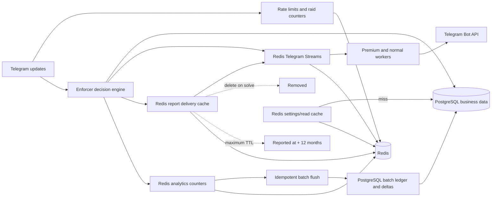

# Enforcer Storage Model Review

This document separates the current rehearsal schema from the proposed production target. The
current PostgreSQL model is an interim compatibility model and is not approved for production.

**Status:** The proposed PostgreSQL and Redis models below are the approved production design
baseline. Schema implementation and migration work must follow this model unless a later reviewed
decision updates this document.

## Current PostgreSQL Model

[//]: # (```mermaid)

[//]: # (erDiagram)

[//]: # (    USERS {)

[//]: # (        bigint user_id PK)

[//]: # (        text name)

[//]: # (        text username)

[//]: # (    })

[//]: # (    GROUPS {)

[//]: # (        bigint chat_id PK)

[//]: # (        text name)

[//]: # (    })

[//]: # (    GROUP_SETTINGS {)

[//]: # (        bigint chat_id PK)

[//]: # (        text setting_group PK)

[//]: # (        jsonb values)

[//]: # (        bigint version)

[//]: # (    })

[//]: # (    GROUP_SETTINGS_REDIS_SYNC {)

[//]: # (        bigint chat_id PK)

[//]: # (        text setting_group PK)

[//]: # (        text redis_key)

[//]: # (        bigint source_revision)

[//]: # (        char source_checksum)

[//]: # (    })

[//]: # (    GROUP_CONTENT_ITEMS {)

[//]: # (        bigint chat_id PK,FK)

[//]: # (        text content_type PK)

[//]: # (        text content)

[//]: # (    })

[//]: # (    CUSTOM_COMMANDS {)

[//]: # (        bigint chat_id PK,FK)

[//]: # (        text trigger PK)

[//]: # (        text content)

[//]: # (        text media_type)

[//]: # (        text file_id)

[//]: # (    })

[//]: # (    GROUP_ENTITLEMENTS {)

[//]: # (        bigint chat_id PK,FK)

[//]: # (        text entitlement PK)

[//]: # (        boolean enabled)

[//]: # (    })

[//]: # (    GROUP_ROLE_ASSIGNMENTS {)

[//]: # (        bigint group_id PK,FK)

[//]: # (        bigint user_id PK,FK)

[//]: # (        text role PK)

[//]: # (    })

[//]: # (    GROUP_USER_POLICIES {)

[//]: # (        bigint group_id PK,FK)

[//]: # (        bigint user_id PK,FK)

[//]: # (        text policy PK)

[//]: # (        boolean enabled)

[//]: # (    })

[//]: # (    WARNING_BALANCES {)

[//]: # (        bigint group_id PK,FK)

[//]: # (        bigint user_id PK,FK)

[//]: # (        text warning_type PK)

[//]: # (        bigint active_quantity)

[//]: # (        bigint lifetime_quantity)

[//]: # (    })

[//]: # (    WARNING_EVENTS {)

[//]: # (        bigint id PK)

[//]: # (        bigint group_id)

[//]: # (        bigint user_id)

[//]: # (        text operation)

[//]: # (    })

[//]: # (    SANCTIONS {)

[//]: # (        bigint id PK)

[//]: # (        bigint group_id)

[//]: # (        bigint user_id)

[//]: # (        text kind)

[//]: # (        text status)

[//]: # (        timestamptz expires_at)

[//]: # (    })

[//]: # (    REPORTS {)

[//]: # (        bigint id PK)

[//]: # (        bigint group_id)

[//]: # (        bigint reporter_user_id)

[//]: # (        bigint reported_user_id)

[//]: # (        bigint solved_by_user_id)

[//]: # (        text status)

[//]: # (    })

[//]: # (    REPORT_DELIVERIES {)

[//]: # (        bigint report_id PK,FK)

[//]: # (        int delivery_index PK)

[//]: # (        text legacy_payload)

[//]: # (    })

[//]: # (    GROUP_USER_STATISTICS {)

[//]: # (        bigint group_id PK)

[//]: # (        bigint user_id PK)

[//]: # (        bigint messages)

[//]: # (    })

[//]: # (    COMPATIBILITY_OUTBOX {)

[//]: # (        uuid id PK)

[//]: # (        text domain)

[//]: # (        text ordering_key)

[//]: # (        jsonb payload)

[//]: # (    })

[//]: # ()
[//]: # (    GROUPS ||--o{ GROUP_CONTENT_ITEMS : owns)

[//]: # (    GROUPS ||--o{ CUSTOM_COMMANDS : owns)

[//]: # (    GROUPS ||--o{ GROUP_ENTITLEMENTS : owns)

[//]: # (    GROUPS ||--o{ GROUP_ROLE_ASSIGNMENTS : owns)

[//]: # (    USERS ||--o{ GROUP_ROLE_ASSIGNMENTS : receives)

[//]: # (    GROUPS ||--o{ GROUP_USER_POLICIES : owns)

[//]: # (    USERS ||--o{ GROUP_USER_POLICIES : receives)

[//]: # (    GROUPS ||--o{ WARNING_BALANCES : owns)

[//]: # (    USERS ||--o{ WARNING_BALANCES : receives)

[//]: # (    REPORTS ||--o{ REPORT_DELIVERIES : delivers)

[//]: # (```)

### Current Problems

- `group_settings.values` is JSONB and not typed or normalized.
- `group_settings` and `group_settings_redis_sync` do not reference `groups`.
- Sanctions, reports, warning events, statistics, audit events, and global roles have missing FKs.
- `report_deliveries` persists transient Telegram synchronization data.
- Report delivery payloads are JSON stored as text.
- The rehearsal timed out because principal backfill attempted millions of user lookups serially.

## Approved PostgreSQL Target

```mermaid
%%{init: {"er": {"useMaxWidth": false}, "themeVariables": {"fontSize": "18px"}}}%%
erDiagram
    USERS {
        bigint user_id PK
        timestamptz created_at
        timestamptz updated_at
    }
    TELEGRAM_ACCOUNTS {
        bigint account_id PK
        bigint telegram_user_id UK
        boolean is_bot
        timestamptz first_seen_at
        timestamptz last_seen_at
    }
    TELEGRAM_ACCOUNT_PROFILES {
        bigint profile_id PK
        bigint account_id FK
        text display_name
        text username
        text language_code
        timestamptz valid_from
        timestamptz valid_to
    }
    USER_IDENTITY_LINKS {
        bigint identity_link_id PK
        bigint user_id FK
        bigint account_id FK
        bigint linked_by_user_id FK
        bigint unlinked_by_user_id FK
        text source
        text reason
        timestamptz linked_at
        timestamptz unlinked_at
    }
    TELEGRAM_CHATS {
        bigint chat_id PK
        bigint telegram_chat_id UK
        text chat_type
        timestamptz first_seen_at
        timestamptz last_seen_at
    }
    GROUPS {
        bigint group_id PK
        bigint chat_id FK,UK
        text title
        text username
        text public_link
        boolean active
        bigint observed_user_count
        timestamptz last_message_at
        timestamptz created_at
        timestamptz updated_at
    }
    TELEGRAM_CHAT_PROFILES {
        bigint chat_profile_id PK
        bigint chat_id FK
        text title
        text username
        timestamptz valid_from
        timestamptz valid_to
    }
    GROUP_MEMBERSHIP_PERIODS {
        bigint membership_id PK
        bigint group_id FK
        bigint account_id FK
        bigint user_id_at_time FK
        timestamptz first_seen_at
        timestamptz last_seen_at
        timestamptz joined_at
        timestamptz left_at
    }
    GROUP_ACCOUNT_OBSERVATIONS {
        bigint group_id PK,FK
        bigint account_id PK,FK
        timestamptz first_seen_at
        timestamptz last_seen_at
    }
    GROUP_USER_OBSERVATIONS {
        bigint group_id PK,FK
        bigint user_id PK,FK
        timestamptz first_seen_at
        timestamptz last_seen_at
    }
    GROUP_SETTINGS {
        bigint group_id PK,FK
        bigint log_chat_id FK
        boolean reports_enabled
        boolean welcome_enabled
        boolean flood_protection_enabled
        boolean delete_last_welcome
        boolean mute_on_join
        smallint maximum_messages
        text flood_action
        smallint maximum_warnings
        text warning_action
        smallint media_warning_limit
        text media_action
        int tempban_minutes
        int tempmute_minutes
        text welcome_format
        text welcome_content
        text welcome_media_file_id
        text welcome_media_file_owner_edition
        boolean rules_private_only
        boolean about_private_only
        boolean modlist_private_only
        boolean extra_private_only
        boolean help_private_only
        bigint version
        timestamptz updated_at
    }
    GROUP_FLOOD_EXCEPTIONS {
        bigint group_id PK,FK
        text content_type PK
        boolean excluded
    }
    GROUP_MEDIA_POLICIES {
        bigint group_id PK,FK
        text media_type PK
        boolean allowed
    }
    GROUP_CHARACTER_POLICIES {
        bigint group_id PK,FK
        text character_class PK
        text action
    }
    GROUP_LENGTH_POLICIES {
        bigint group_id PK,FK
        text scope PK
        boolean enabled
        int maximum_characters
        int maximum_lines
        text action
    }
    GROUP_CONTENT_ITEMS {
        bigint group_id PK,FK
        text content_type PK
        text content
    }
    CUSTOM_COMMANDS {
        bigint group_id PK,FK
        text trigger PK
        text content
        text media_type
        text file_id
        text file_owner_edition
        text caption
    }
    GROUP_ENTITLEMENTS {
        bigint group_id PK,FK
        text entitlement PK
        boolean enabled
        timestamptz expires_at
    }
    GROUP_ROLE_ASSIGNMENTS {
        bigint assignment_id PK
        bigint group_id FK
        bigint user_id FK
        text role
        timestamptz assigned_at
        timestamptz revoked_at
    }
    GROUP_ELEVATION_BLOCKS {
        bigint block_id PK
        bigint group_id FK
        bigint user_id FK
        timestamptz blocked_at
        timestamptz revoked_at
    }
    GROUP_USER_PREFERENCES {
        bigint group_id PK,FK
        bigint user_id PK,FK
        boolean admin_notifications_disabled
        boolean reports_blocked
        boolean watch_disabled
        boolean tag_all_subscribed
        timestamptz updated_at
    }
    GLOBAL_ROLE_ASSIGNMENTS {
        bigint assignment_id PK
        bigint user_id FK
        text role
        timestamptz assigned_at
        timestamptz revoked_at
    }
    WARNING_BALANCES {
        bigint group_id PK,FK
        bigint user_id PK,FK
        text warning_type PK
        bigint active_quantity
        bigint lifetime_quantity
    }
    WARNING_EVENTS {
        bigint warning_event_id PK
        bigint group_id FK
        bigint account_id FK
        bigint user_id_at_time FK
        bigint actor_user_id FK
        bigint report_id FK
        text warning_type
        text operation
        bigint quantity
        text reason
        timestamptz occurred_at
    }
    SANCTIONS {
        bigint sanction_id PK
        bigint group_id FK
        bigint account_id FK
        bigint user_id_at_time FK
        bigint actor_user_id FK
        bigint trigger_warning_event_id FK
        bigint report_id FK
        text kind
        text status
        text reason
        timestamptz imposed_at
        timestamptz expires_at
        timestamptz resolved_at
    }
    GLOBAL_SANCTIONS {
        bigint global_sanction_id PK
        bigint account_id FK
        bigint user_id_at_time FK
        bigint actor_user_id FK
        text kind
        text status
        text reason
        timestamptz imposed_at
        timestamptz expires_at
        timestamptz resolved_at
    }
    REPORTS {
        bigint report_id PK
        bigint group_id FK
        bigint reporter_user_id FK
        bigint reporter_account_id FK
        text reporter_display
        bigint target_user_id FK
        bigint target_account_id FK
        text target_display
        bigint solver_user_id FK
        text solver_display
        bigint report_message_id
        bigint target_message_id
        text status
        text resolution_action
        timestamptz reported_at
        timestamptz resolved_at
    }
    MESSAGE_METADATA {
        bigint group_id PK,FK
        bigint telegram_message_id PK
        bigint account_id FK
        bigint user_id_at_time FK
        bigint reply_to_message_id
        text message_type
        boolean has_media
        timestamptz sent_at
        timestamptz edited_at
        timestamptz deleted_at
    }
    GROUP_DAILY_ANALYTICS {
        bigint group_id PK,FK
        date day PK
        bigint message_count
        bigint active_user_count
        bigint join_count
        bigint leave_count
    }
    GROUP_ACCOUNT_DAILY_ANALYTICS {
        bigint group_id PK,FK
        bigint account_id PK,FK
        date day PK
        bigint message_count
        timestamptz first_message_at
        timestamptz last_message_at
    }
    GROUP_USER_DAILY_ANALYTICS {
        bigint group_id PK,FK
        bigint user_id PK,FK
        date day PK
        bigint message_count
        timestamptz first_message_at
        timestamptz last_message_at
    }
    ACCOUNT_MESSAGE_TOTALS {
        bigint account_id PK,FK
        bigint message_count
        timestamptz captured_at
    }
    GROUP_ACCOUNT_MESSAGE_TOTALS {
        bigint group_id PK,FK
        bigint account_id PK,FK
        bigint message_count
        timestamptz last_message_at
        timestamptz captured_at
    }
    BOT_STATISTIC_BASELINES {
        text edition PK
        bigint message_count
        bigint user_count
        bigint ban_count
        bigint kick_count
        timestamptz captured_at
    }
    ANALYTICS_FLUSH_BATCHES {
        uuid batch_id PK
        text edition
        text source
        timestamptz committed_at
    }
    ANALYTICS_FLUSH_BATCH_ITEMS {
        uuid batch_id PK,FK
        bigint group_id PK,FK
        bigint account_id PK,FK
        date day PK
        bigint message_delta
        bigint active_user_delta
        bigint join_delta
        bigint leave_delta
    }
    GROUP_AUDIT_EVENTS {
        bigint event_id PK
        bigint group_id FK
        bigint actor_user_id FK
        bigint subject_user_id FK
        text event_type
        timestamptz occurred_at
    }
    STORAGE_OUTBOX {
        uuid outbox_id PK
        text domain
        text ordering_key
        jsonb payload
        timestamptz created_at
        timestamptz delivered_at
    }

    TELEGRAM_ACCOUNTS ||--o{ TELEGRAM_ACCOUNT_PROFILES : has_history
    USERS ||--o{ USER_IDENTITY_LINKS : is_linked
    USERS ||--o{ USER_IDENTITY_LINKS : links
    TELEGRAM_ACCOUNTS ||--o{ USER_IDENTITY_LINKS : identifies
    TELEGRAM_CHATS ||--o{ TELEGRAM_CHAT_PROFILES : has_history
    TELEGRAM_CHATS ||--o| GROUPS : represents
    GROUPS ||--o| GROUP_SETTINGS : configures
    TELEGRAM_CHATS o|--o{ GROUP_SETTINGS : receives_logs
    GROUPS ||--o{ GROUP_FLOOD_EXCEPTIONS : excludes
    GROUPS ||--o{ GROUP_MEDIA_POLICIES : permits
    GROUPS ||--o{ GROUP_CHARACTER_POLICIES : filters
    GROUPS ||--o{ GROUP_LENGTH_POLICIES : limits
    GROUPS ||--o{ GROUP_CONTENT_ITEMS : owns
    GROUPS ||--o{ CUSTOM_COMMANDS : owns
    GROUPS ||--o{ GROUP_ENTITLEMENTS : owns
    GROUPS ||--o{ GROUP_ROLE_ASSIGNMENTS : owns
    USERS ||--o{ GROUP_ROLE_ASSIGNMENTS : receives
    GROUPS ||--o{ GROUP_ELEVATION_BLOCKS : owns
    USERS ||--o{ GROUP_ELEVATION_BLOCKS : blocks
    GROUPS ||--o{ GROUP_USER_PREFERENCES : owns
    USERS ||--o{ GROUP_USER_PREFERENCES : configures
    USERS ||--o{ GLOBAL_ROLE_ASSIGNMENTS : receives
    GROUPS ||--o{ GROUP_MEMBERSHIP_PERIODS : has
    TELEGRAM_ACCOUNTS ||--o{ GROUP_MEMBERSHIP_PERIODS : joins
    USERS ||--o{ GROUP_MEMBERSHIP_PERIODS : attributed_to
    GROUPS ||--o{ GROUP_ACCOUNT_OBSERVATIONS : observes
    TELEGRAM_ACCOUNTS ||--o{ GROUP_ACCOUNT_OBSERVATIONS : appears_in
    GROUPS ||--o{ GROUP_USER_OBSERVATIONS : observes
    USERS ||--o{ GROUP_USER_OBSERVATIONS : appears_in
    GROUPS ||--o{ WARNING_BALANCES : owns
    USERS ||--o{ WARNING_BALANCES : receives
    GROUPS ||--o{ WARNING_EVENTS : records
    TELEGRAM_ACCOUNTS ||--o{ WARNING_EVENTS : receives
    USERS ||--o{ WARNING_EVENTS : attributed_to
    USERS ||--o{ WARNING_EVENTS : issues
    REPORTS o|--o{ WARNING_EVENTS : results_in
    GROUPS ||--o{ SANCTIONS : owns
    TELEGRAM_ACCOUNTS ||--o{ SANCTIONS : receives
    USERS ||--o{ SANCTIONS : attributed_to
    USERS ||--o{ SANCTIONS : imposes
    WARNING_EVENTS o|--o{ SANCTIONS : triggers
    REPORTS o|--o{ SANCTIONS : results_in
    TELEGRAM_ACCOUNTS ||--o{ GLOBAL_SANCTIONS : receives
    USERS ||--o{ GLOBAL_SANCTIONS : attributed_to
    USERS ||--o{ GLOBAL_SANCTIONS : imposes
    GROUPS ||--o{ REPORTS : owns
    USERS ||--o{ REPORTS : reports
    USERS ||--o{ REPORTS : targets
    USERS ||--o{ REPORTS : solves
    TELEGRAM_ACCOUNTS ||--o{ REPORTS : reports
    TELEGRAM_ACCOUNTS ||--o{ REPORTS : targets
    GROUPS ||--o{ MESSAGE_METADATA : contains
    USERS ||--o{ MESSAGE_METADATA : attributed_to
    TELEGRAM_ACCOUNTS ||--o{ MESSAGE_METADATA : authors
    MESSAGE_METADATA o|--o{ MESSAGE_METADATA : replies_to
    MESSAGE_METADATA o|--o{ REPORTS : report_message
    MESSAGE_METADATA o|--o{ REPORTS : target_message
    GROUPS ||--o{ GROUP_DAILY_ANALYTICS : aggregates
    GROUPS ||--o{ GROUP_ACCOUNT_DAILY_ANALYTICS : aggregates
    TELEGRAM_ACCOUNTS ||--o{ GROUP_ACCOUNT_DAILY_ANALYTICS : contributes
    GROUPS ||--o{ GROUP_USER_DAILY_ANALYTICS : aggregates
    USERS ||--o{ GROUP_USER_DAILY_ANALYTICS : contributes
    TELEGRAM_ACCOUNTS ||--o| ACCOUNT_MESSAGE_TOTALS : totals
    GROUPS ||--o{ GROUP_ACCOUNT_MESSAGE_TOTALS : totals
    TELEGRAM_ACCOUNTS ||--o{ GROUP_ACCOUNT_MESSAGE_TOTALS : totals
    ANALYTICS_FLUSH_BATCHES ||--|{ ANALYTICS_FLUSH_BATCH_ITEMS : contains
    GROUPS ||--o{ ANALYTICS_FLUSH_BATCH_ITEMS : receives
    TELEGRAM_ACCOUNTS ||--o{ ANALYTICS_FLUSH_BATCH_ITEMS : contributes
    GROUPS ||--o{ GROUP_AUDIT_EVENTS : records
    USERS ||--o{ GROUP_AUDIT_EVENTS : performs
    USERS ||--o{ GROUP_AUDIT_EVENTS : concerns
```

`USERS`, `TELEGRAM_ACCOUNTS`, `TELEGRAM_CHATS`, and `GROUPS` each use independent generated sequences;
equal numeric values across those columns are coincidental and have no shared meaning. Telegram user
and chat IDs remain immutable external identifiers. `TELEGRAM_CHATS` represents every Telegram
destination, including channels and private chats; `GROUPS` is the managed-group extension and only
exists for chats where Enforcer owns group configuration and moderation state. `TELEGRAM_CHAT_PROFILES`
preserves observed title and username history for any Telegram chat. `USER_IDENTITY_LINKS` is the sole authority
for linking one or more Telegram accounts to an Enforcer user and records link/unlink provenance.
Profile tables preserve observed names, usernames, language codes, and group titles over time.

Membership facts remain account-based so identity merges never rewrite history. User-at-time columns
are immutable attribution snapshots; current identity is resolved through the active identity link.
Repeated leave/rejoin, role, and block periods use generated IDs rather than overwriting old rows.

`GROUP_SETTINGS` contains typed scalar settings, including `log_chat_id -> TELEGRAM_CHATS.chat_id`.
Setting a log destination creates or resolves only a Telegram chat, never a managed `GROUPS` row; its
type remains `unknown` until Telegram identifies it as a group, supergroup, channel, or private chat.
Only repeating policy values have child tables. Per-user choices within a group are typed columns in
`GROUP_USER_PREFERENCES`, not text-keyed EAV rows. A separate global user-settings table is deferred
until Enforcer supports a real global preference such as an explicit language override.

Warnings and sanctions are intentionally separate. `WARNING_EVENTS` records each warn, prewarn,
media warning, removal, reset, or decay; `WARNING_BALANCES` is the current and lifetime projection.
`SANCTIONS.trigger_warning_event_id` records the warning that caused a ban, tempban, kick, mute, or
tempmute. Both event types can reference the report that caused them, preserving the queryable chain
`REPORTS -> WARNING_EVENTS -> SANCTIONS`. Global sanctions remain separate because they are not owned
by one group.

Message metadata and daily aggregates are durable PostgreSQL history. Redis can accumulate live
counters, but each batch and its deltas are committed with the aggregate update in one PostgreSQL
transaction. Account-level aggregates remain stable across identity merges; user-level aggregates
are a convenient attribution projection. The total and baseline tables preserve legacy counters
that cannot be accurately assigned to historical calendar days during migration.

Telegram file IDs are scoped to the bot that received them. Every persisted file ID therefore carries
`file_owner_edition` (`normal`, `premium`, or `legacy_unknown`) so dispatch can select the correct bot
and legacy files are never silently assumed to work from both editions.

### Required Constraints And Indexes

- Only one active `USER_IDENTITY_LINKS` row may exist per Telegram account.
- Only one open membership period may exist per group/account, and only one active role or elevation
  block may exist per matching scope and type.
- Warning, sanction, and report references must share the same group and target account. When both a
  report and triggering warning are present on a sanction, the warning must reference that report.
- Open reports have a partial unique index on `(group_id, target_message_id)`.
- Message replies and report message references use composite `(group_id, telegram_message_id)` FKs.
- Profile history has non-overlapping validity periods and case-insensitive username indexes.
- Message metadata and daily analytics are partitioned/indexed by date according to retention policy.
- Check constraints define allowed role, warning operation, sanction kind/status, report status/action,
  media type, and moderation action values; sanction kinds include kick.

## Approved Redis Model

Redis contains operational state. PostgreSQL is authoritative for business data, but polling offsets
and pending Telegram actions require Redis persistence or explicit replay/reconciliation procedures.



### Redis Key Families

| Family | Purpose | Retention |
|---|---|---|
| `enforcer:{edition}:telegram:*` | Idempotent action queues, delayed retries, dead letters | Bounded by documented queue/DLQ policy |
| `spam:*`, `spam:added:*`, cooldowns | Flood and raid protection | Seconds/minutes |
| `enforcer:capability:*` | Bot membership/admin capability | 5 minutes to 1 hour |
| `enforcer:report:{id}:deliveries` | Admin delivery index | Delete on solve; max 12 months |
| `enforcer:report:{id}:delivery:{admin}` | Telegram message IDs needed for edits | Delete on solve; max 12 months |
| `enforcer:report:open-target:{group}:{message}` | Duplicate open-report lock | Delete on solve; max 12 months |
| settings cache keys | Typed PostgreSQL projections by group/version | Short TTL/invalidation |
| `enforcer:analytics:{batch}:*` | Message, active-user, join, and leave deltas awaiting flush | Delete after PostgreSQL batch commit |
| update offsets | Polling resume state; loss can replay updates | Persistent and backed up |

Report delivery JSON may remain in Redis because it is synchronization state, not durable report
history. PostgreSQL keeps only who reported, who/what was reported, who resolved it, the action, and
timestamps. A PostgreSQL partial unique index on an open report's group and target message remains
the authoritative duplicate-report guard.

Analytics idempotency is durable in `ANALYTICS_FLUSH_BATCHES`, not an expiring Redis marker. The
aggregate updates, batch details, and committed batch ID are written in one PostgreSQL transaction;
Redis deltas are deleted only after that transaction commits. Queue actions also need stable
idempotency keys, bounded dead-letter retention, and a documented recovery process.

## Rehearsal Results So Far

- Redis snapshot: 19,043,477 keys.
- Known groups: 36,441.
- Username index entries: 4,412,327.
- Schema migrations: 6, applied in 2.3 seconds.
- Group settings: 364,410 source snapshots processed in 10 minutes after batching, zero failures.
- Canonical settings rows: 310,662 because absent hashes do not create canonical rows.
- Principal/content backfill was stopped after 20 minutes with no committed rows. Its per-user Redis
  reads over 4.4 million usernames require a bulk/streaming redesign before another run.

## Remaining Product Decisions

1. Confirm the legacy `yes`/`no` polarity mapping for every feature. Several current values are
   inverted (`Flood=yes` currently means disabled).
2. Confirm report resolution action vocabulary: proposed values are `solved`, `dismissed`, `warned`,
   `kicked`, `banned`, and `deleted`.
3. Confirm report synchronization expiration: delete immediately on solve, otherwise expire exactly
   12 months after report creation.
4. Confirm whether `rules/about/modlist/extra/help` should remain “private-only” booleans or be renamed
   to another product concept.
